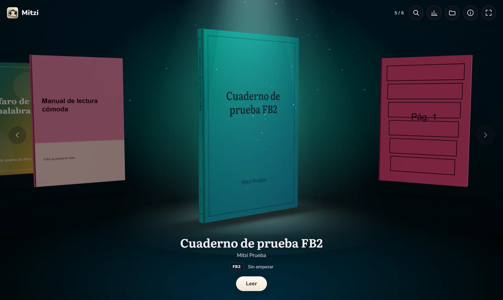
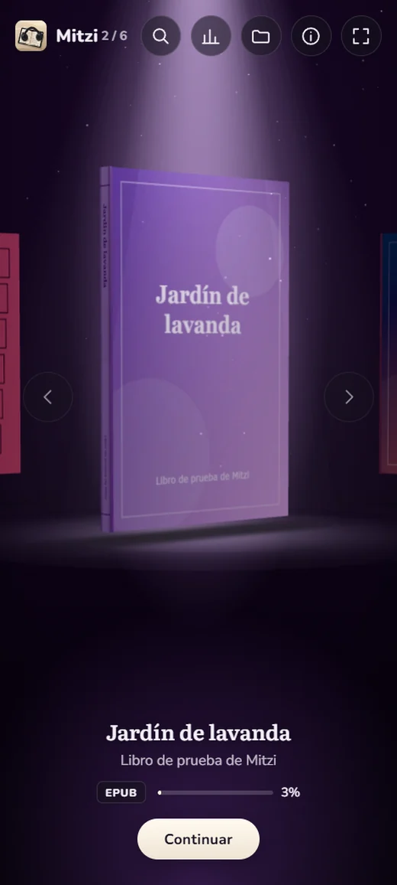
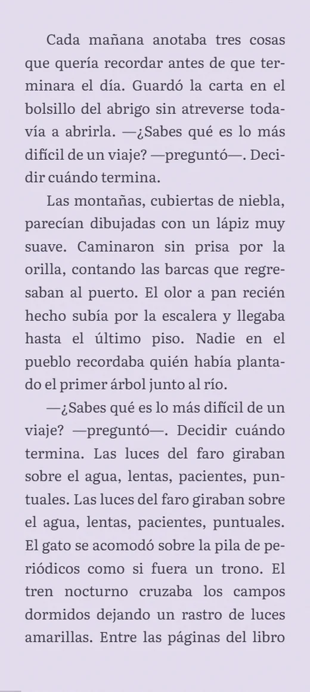
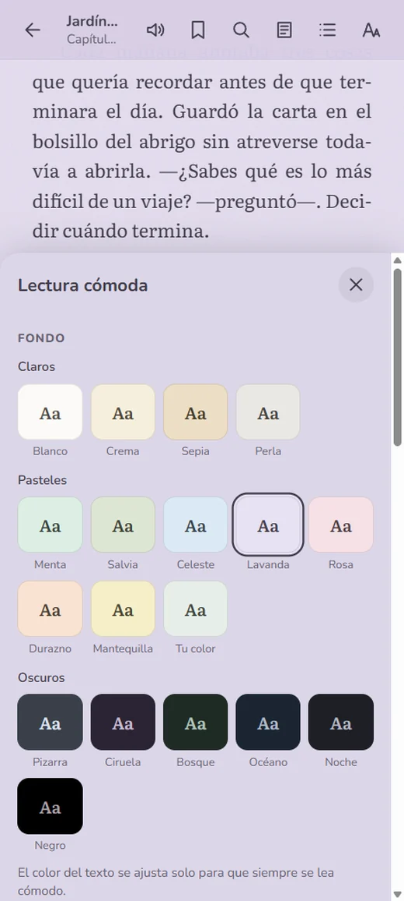
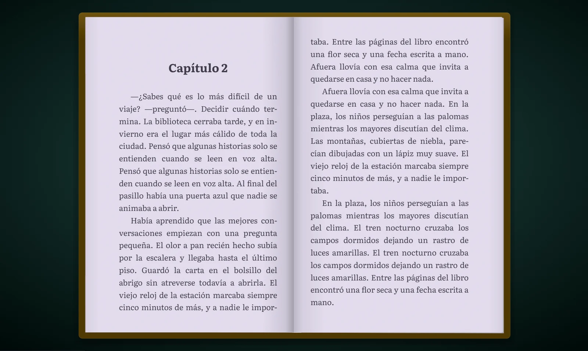
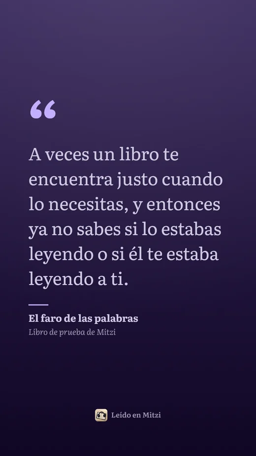

<div align="center">


# Mitzi

**Tu biblioteca, como el selector de un videojuego. Tus libros, como en papel.**

Lector de libros electrónicos y cómics para **Android** y **Windows**. Gratis, sin anuncios, sin cuentas y de código abierto.

[](https://github.com/luisnajm26-creator/mitzi/releases/latest)
[](https://github.com/luisnajm26-creator/mitzi/releases)
[](LICENSE)
[](#descargar)

<a href="https://github.com/luisnajm26-creator/mitzi/releases/latest"></a>
<a href="https://github.com/luisnajm26-creator/mitzi/releases/latest"></a>

<br />



</div>

> [!NOTE]
> **Mitzi no trae libros.** Es una app vacía: agregas tus propios archivos y Mitzi los encuentra sola. No distribuimos libros ni contenido con derechos de autor (las capturas usan libros de prueba hechos para el proyecto).

## Así se ve

<table>
  <tr>
    <td width="33%"></td>
    <td width="33%"></td>
    <td width="33%"></td>
  </tr>
  <tr>
    <td align="center"><sub>Biblioteca 3D en el teléfono</sub></td>
    <td align="center"><sub>Lectura con separación silábica</sub></td>
    <td align="center"><sub>17 fondos y el texto se ajusta solo</sub></td>
  </tr>
</table>


<p align="center"><sub>En la PC y en tablets en horizontal, el libro se abre a dos páginas, con el grosor de hojas que cambia según tu avance y una hoja de papel que gira al pasar página.</sub></p>

## Qué hace

**📚 Biblioteca**
- Se llena sola: eliges carpetas y Mitzi detecta los libros nuevos, sin reiniciar.
- Carrusel 3D: el libro elegido gira bajo un foco de luz y el fondo toma los colores de su portada.
- Explorador con búsqueda (sin importar tildes), filtros y libros agrupados por serie o por autor. Pensado para miles de libros.
- **Formatos:** EPUB, PDF, Kindle (MOBI, AZW, AZW3, sin DRM), FB2 y cómics CBZ.

**📖 Lectura**
- Libro abierto con relieve y una hoja que gira como papel: la puedes arrastrar con el dedo o el ratón.
- 17 fondos (claros, pasteles y oscuros) más uno a tu gusto; el color del texto se calcula para que siempre se lea cómodo.
- 5 tipografías (incluida OpenDyslexic), tamaño, interlineado, márgenes, separación silábica en 7 idiomas, textura de papel, brillo, filtro cálido y modo noche automático.
- Gestos: pellizcar para el tamaño de letra y deslizar por el borde para el brillo.
- Cuánto falta del capítulo y del libro, a tu ritmo.

**✍️ Herramientas**
- Marcadores, subrayados en 5 colores y notas, con exportación a Markdown.
- Búsqueda dentro del libro, y definir o traducir lo que seleccionas.
- **Tu lectura:** minutos por día, racha y una meta diaria. Todo queda en tu dispositivo.

**🎧 Voz**
- Lectura en voz alta que resalta la oración y pasa de página sola, con temporizador para dormir.
- En la PC, voces naturales con un servidor de voz local como [Kokoro-FastAPI](https://github.com/remsky/Kokoro-FastAPI).

**💬 Compartir citas**



Seleccionas un fragmento y Mitzi lo convierte en una tarjeta para tus historias o publicaciones, con la letra con la que lees y 4 diseños. En Android va directo al menú de compartir; en la PC se guarda o se copia.

<br clear="right" />

**📱 Hecha para Android sin Google**
- Probada en Huawei con EMUI (sin servicios de Google) y en navegadores internos viejos.
- Pantalla completa de verdad, gesto atrás y 120 Hz durante las animaciones.
- Se actualiza desde la misma app, comprobando la huella de cada descarga.

## Descargar

1. Entra a **[Releases](https://github.com/luisnajm26-creator/mitzi/releases/latest)**.
2. Elige tu archivo:
   - **Android:** `Mitzi-x.y.z.apk`. Al abrirlo, el teléfono te pedirá permiso para instalar apps de esta fuente.
   - **Windows:** `Mitzi-Setup-x.y.z.exe`. Windows puede avisar «Windows protegió tu PC» porque el instalador no tiene certificado de firma: *Más información* › *Ejecutar de todos modos*.
3. Abre Mitzi, elige la carpeta donde guardas tus libros y listo.

Mitzi revisa una vez al día si hay una versión nueva y la instala comprobando su huella SHA-256 (`SHA256SUMS.txt`). Descárgala solo desde este repositorio.

## Fluidez y batería

- Todas las animaciones avanzan según el tiempo real, nunca por cuadros: van igual a 60, 90 o 120 Hz.
- La biblioteca deja de dibujar cuando no está en pantalla o cuando no la tocas por un rato.
- Con la página quieta, el lector no gasta GPU.
- Si un equipo no alcanza, la biblioteca baja su resolución sola.

<details>
<summary><b>Para desarrolladores</b></summary>

<br />

Necesitas [Node.js](https://nodejs.org) 20 o más reciente y Git.

```bash
git clone --recursive https://github.com/luisnajm26-creator/mitzi.git
cd mitzi
npm install
npm run demo          # crea libros de prueba en libros-prueba/demo
npm run electron:dev  # app de PC
```

`npm run dev` abre la app en el navegador (lee los libros de `libros-prueba/`). Si clonaste sin `--recursive`, ejecuta `git submodule update --init`.

| Comando | Qué hace |
|---|---|
| `npm run dev` | App en el navegador con recarga en vivo |
| `npm run electron:dev` | App de PC (Electron) en modo desarrollo |
| `npm run build` | Compila todo para producción |
| `npm run electron` | Abre la app de PC con la versión compilada |
| `npm run demo` | Genera libros de prueba con texto original |
| `npm run android` | APK de prueba («Mitzi Prueba», se instala junto a la oficial); necesita Java 21 y el Android SDK |
| `npm run typecheck` | Revisa los tipos de TypeScript |
| `npm run instalador` | Crea el instalador de Windows en `release/` |
| `npm run llave` | Crea la llave para firmar el APK (una sola vez; se guarda en `~/.mitzi`, fuera del repositorio) |
| `npm run publicar` | Arma una versión (instalador, APK firmado y `SHA256SUMS.txt`); con `-- --subir` la publica en GitHub |
| `npx electron scripts/capturas.mjs` | Rehace las capturas de este README (con `npm run dev` abierto) |

```
src/
  app/        arranque, pantalla de inicio, gesto atrás, actualizaciones y datos del autor
  platform/   lo que cambia entre PC, Android y navegador (carpetas, archivos, pantalla completa)
  library/    base de datos local, detección de libros, portadas, paletas y estadísticas
  shelf/      carrusel 3D (three.js + react-three-fiber), explorador, «Acerca de» y «Tu lectura»
  reader/     lector: motores EPUB (foliate-js) y PDF (pdf.js), hoja que gira, temas, notas, voz y citas
electron/     proceso principal de la app de PC
android/      proyecto de Android (Capacitor) con su plugin propio
vendor/       foliate-js como submódulo
docs/         listas de pruebas, notas de cada versión y capturas
```

React + TypeScript + Vite, empaquetado con Electron (Windows) y Capacitor (Android). Los motores de EPUB y PDF comparten una misma interfaz (`src/reader/engines/types.ts`), así el relieve del libro, las notas y la voz no tienen que distinguir el formato.

¿Quieres ayudar? Lee [CONTRIBUTING.md](CONTRIBUTING.md). [CLAUDE.md](CLAUDE.md) es el mapa del proyecto: cómo funciona por dentro y las trampas conocidas.

</details>

## Cómo se hizo

Mitzi se hizo con ayuda de Claude, una IA de Anthropic. La idea, el diseño, las decisiones y las pruebas en dispositivos reales (PC con Windows, Huawei Pura 70 Ultra y MatePad 11.5) son mías; la IA escribió gran parte del código. Lo digo abiertamente porque así se programa hoy, y porque este proyecto también es mi forma de aprender: poco a poco voy escribiendo yo las partes nuevas, con su guía.

## Autor

Hola, soy **Luis A.** Hice Mitzi por puro gusto personal, a raíz de mi afición reciente por la lectura. Si te interesa hacer un proyecto juntos, me encantará que me contactes: [GitHub](https://github.com/luisnajm26-creator) · luisnajm26@gmail.com

> *The Universe is, and we are.*

<details>
<summary><b>Créditos</b></summary>

<br />

- [foliate-js](https://github.com/johnfactotum/foliate-js) (MIT): motor de EPUB
- [pdf.js](https://github.com/mozilla/pdf.js) (Apache-2.0): motor de PDF
- [three.js](https://threejs.org) y [react-three-fiber](https://github.com/pmndrs/react-three-fiber) (MIT): carrusel 3D
- [hyphen](https://github.com/ytiurin/hyphen) (ISC): separación silábica
- Tipografías Literata, Merriweather, Atkinson Hyperlegible Next, Nunito y OpenDyslexic (SIL Open Font License) vía [Fontsource](https://fontsource.org)

</details>

## Licencia

[MIT](LICENSE): puedes usar, copiar, modificar y distribuir Mitzi libremente. Si haces tu propia versión, usa otro nombre y otro ícono para que nadie la confunda con esta.

---

<details>
<summary><b>English</b></summary>

<br />

**Mitzi** is a free, open-source e-book and comic reader for Android and Windows. Your library is shown like a game-console carousel: the selected book spins under a spotlight and the background takes the colors of its cover. On wide screens the book opens into two pages with a paper sheet that turns. It reads EPUB, PDF, MOBI/AZW3, FB2 and CBZ, offers pastel and dark themes with auto-contrast text, highlights and notes, read-aloud, quote cards for social media, and updates itself from this repository's Releases. It works on phones without Google services.

**Mitzi ships with no books**: you add your own files. Built with the help of Claude (AI): the idea, design and device testing are the author's. Contributions are welcome; see [CONTRIBUTING.md](CONTRIBUTING.md).

</details>
